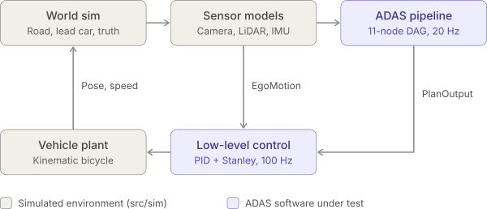
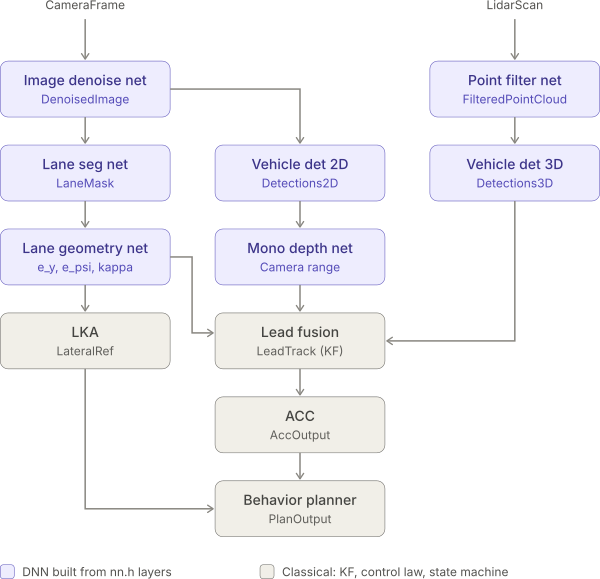

# adas_sim — a small, readable ADAS pipeline in C

This is a closed-loop simulation of a highway ADAS stack with Adaptive Cruise Control (ACC) and Lane Keeping Assist (LKA).

Two simulated sensors feed seven small DNNs and a Kalman filter. The DNNs are real conv and dense layers with hand-set weights. The filter output goes to a planner, the planner drives low-level controllers, and the controllers drive a kinematic-bicycle car model. The loop is closed through the simulated world.

It is plain C11 with no dependencies besides `libm` and no heap allocation, and the result is deterministic for a given compiler. GCC and clang round some float expressions differently, so their logs differ in the last digits.



```
make run            # build + run the selected scenario, writes out/<scenario>_seed<N>.csv
make plot           # also writes the matching .pdf (needs python3 + matplotlib)
make debug          # -O0 -g with AddressSanitizer + UBSan
make debug-test     # unit + integration tests under ASan/UBSan
make test           # unit tests + closed-loop integration tests of every scenario
make format         # clang-format every source (make format-check to verify)
make lint           # clang-tidy (needs compile_commands.json, built on demand)
make check          # format-check + warnings-as-errors build + test + lint
make clean          # remove build/ (out/ is kept)
make WERROR=1 ...   # treat compiler warnings as errors in any target
make CC=gcc ...     # build with another compiler (default: clang)
```

---

## 1. The pipeline



Blue nodes are DNNs built from `nn.h` layers; beige nodes are classical
algorithms (Kalman filter, control law, state machine). `EgoMotion` (100 Hz)
bypasses the DAG and goes straight to the low-level controllers.

The stages are listed below in DAG order. The program prints the real stage list at startup.

| Stage | Nodes (parallel within a stage) | What happens |
|---|---|---|
| 0 | `image_denoise_net`, `point_filter_net` | Sensor pre-processing. Camera and LiDAR run in parallel. |
| 1 | `lane_seg_net`, `vehicle_det_2d`, `vehicle_det_3d` | Two camera heads share the denoised image. LiDAR detection runs alongside them. |
| 2 | `lane_geometry_net`, `mono_depth_net` | Estimation heads, downstream of perception. |
| 3 | `lead_fusion`, `lka` | Fusion needs both sensor branches **and** the lane, for in-path target selection. |
| 4 | `acc` | Spacing policy. |
| 5 | `behavior_planner` | Arbitration: ACC + LKA → one plan. |

Timing comes from a deterministic DAG scheduler. It executes nodes in topological order, which keeps runs reproducible, and simulates parallel timing: each node starts when its slowest dependency finishes. The run summary reports the critical-path latency next to the latency of a fully serial run (17 ms vs. 39 ms). The critical-path latency is also injected into the closed loop (see [Rates and latency](#rates-and-latency)).

### The DNNs (all in `src/perception` and `src/estimation`)

All networks are built from two layer types in `src/nn/nn.c` (`Conv2dLayer`, `DenseLayer`). The weights are hand-set so their behavior is explainable. In a real system they would come from training.

| Network | Architecture | Output type |
|---|---|---|
| `ImageDenoiseNet` | Conv3×3(1→1), Gaussian, ReLU | `DenoisedImage` |
| `LaneSegNet` | Conv3×3(1→2: brightness, LoG ridge), ReLU → Conv1×1(2→1), sigmoid | `LaneMask` |
| `VehicleDetector2D` | Conv1×1 "darkness", ReLU → Conv3×3, sigmoid heat map → peak/box decode + NMS | `Detections2D` |
| `PointFilterNet` | Per-point shared MLP: Dense(3→2), ReLU → Dense(2→1), sigmoid | `FilteredPointCloud` |
| `VehicleDetector3D` | BEV voxelization → Conv3×3, ReLU → peak decode → box fit | `Detections3D` |
| `LaneGeometryNet` | Row-anchor soft-argmax features → Dense(6→3) head, with weights set to the LS pseudo-inverse | `LaneEstimate` (`e_y`, `e_psi`, `kappa`) |
| `MonoDepthNet` | Box features [1/v_bottom, 1/h, 1/w] → Dense(3→3), ReLU → Dense(3→1) | `DepthEstimates` |

### Estimation, planning, control

- **`lead_fusion`**: a constant-velocity Kalman filter on `[d, v_rel]`.
  - Sequential range updates come from LiDAR (σ = 0.15 m) and the camera (σ grows with range). Both pass a χ² gate.
  - Track handling covers confirmation, coasting and deletion, plus a divergence guard that re-seeds the state from LiDAR.
- **`acc`**: constant time-gap policy.
  - Desired gap: `d_des = D0 + T_gap·v`.
  - Following: `a_follow = k_d(d − d_des) + k_vr·v_rel`.
  - Cruise: `a_cruise = k_v(v_set − v)`.
- **`lka`**: activation logic. It re-expresses the lane errors at the front axle.
- **`behavior_planner`**: a mode state machine with `CRUISE`, `FOLLOW` and `EMERGENCY_BRAKE`. Emergency braking engages on time-to-collision (TTC), with hysteresis so it doesn't chatter.
- **`longitudinal_controller`**: feed-forward plus PID on acceleration. Its output is split into throttle and brake.
- **`lateral_controller`**: Stanley, `δ = θ_e + atan(k·e_fa / (v + k_soft))`.
- **Plant** (`vehicle_model`): kinematic bicycle at the rear axle, with first-order powertrain and steering lags, drag and rolling resistance.

### Rates and latency

The base step is 10 ms. Control and the plant run at 100 Hz. Sensors and the pipeline run at 20 Hz (`PIPELINE_DECIMATION`).

Each plan goes through a delay line (`pipeline/plan_delay.c`) before the controllers see it. It is released `SENSOR_LATENCY_MS` plus the pipeline's critical-path latency after its sensors were captured, rounded up to whole 10 ms steps. With the defaults that is 20 ms + 17 ms, which rounds up to 40 ms. The controllers hold the newest released plan until the next one arrives (zero-order hold). The `delay_ms` log column and the run summary report the injected delay. Set `LATENCY_INJECTION` to 0 in `config/params.h` to apply each plan in the step its sensors were captured, as before.

The node latencies in `adas_pipeline.c` are nominal figures for production-sized networks on an automotive ECU. They are not the cost of the tiny hand-set networks here, which run in under 0.6 ms each on a desktop CPU.

---

## 2. Conventions

- **Frames:** ISO 8855 — x forward, y left, z up, yaw counter-clockwise positive.
  - The world frame is fixed.
  - The ego frame sits at the rear-axle center. All sensors are mounted there.
- **Lane state:**
  - The lane center line is `y_c(x) = c0 + c1·x + c2·x²` in the ego frame.
  - `e_y = −c0` is the vehicle's offset from the lane center, left positive.
  - `e_psi = −atan(c1)` is the vehicle's heading relative to the lane.
  - `kappa = 2·c2` is the curvature, positive for a left curve.
- **ACC state:**
  - `d` is the gap from the ego reference point to the lead's rear face.
  - `v_rel = v_lead − v_ego`, so it is negative when closing.
- **Units:** SI everywhere. The name suffix gives the unit: `_m`, `_mps`, `_mps2`, `_rad`, `_1pm`, `_s`, `_ms`.
- **Messages:** every message starts with a `MsgHeader {seq, stamp_s}`, which is propagated from the sensor frame.
- **Module API:** `xxx_init(Module*)` and `xxx_infer/step/compute(Module*, const In*, Out*)`.
  - Inputs are `const`.
  - Modules keep their state and scratch buffers in their own struct.
  - Nothing is global except the two large objects in `sim_runner.c`.

---

## 3. Directory layout

```
adas_sim/
├── Makefile                     build, test, format, lint targets
├── LICENSE                      BSD 3-Clause
├── .clang-format  .clang-tidy   style and static-analysis configuration
├── .clangd                      points clangd at compile_commands.json
├── .gitignore
├── config/
│   └── params.h                 every tunable constant (units in the names)
├── include/                     public headers, mirrors src/
│   ├── types/                   ALL message/data types, one header per layer
│   │   ├── common_types.h       Vec2, Vec3, Pose2D, MsgHeader
│   │   ├── sensor_types.h       CameraFrame, LidarScan, EgoMotion, SensorFrame
│   │   ├── perception_types.h   DenoisedImage, LaneMask, Detections2D/3D, ...
│   │   ├── estimation_types.h   LaneEstimate, DepthEstimates, LeadTrack
│   │   ├── planning_types.h     DriverInput, AccOutput, LateralRef, PlanOutput
│   │   ├── control_types.h      ActuatorCmd
│   │   ├── vehicle_types.h      VehicleState
│   │   └── world_types.h        RoadGeometry, WorldState, GroundTruth
│   ├── common/                  math_utils.h, rng.h, camera_geometry.h (calibration)
│   ├── nn/                      nn.h: Tensor, Conv2dLayer, DenseLayer
│   ├── sim/  perception/  estimation/  planning/  control/  pipeline/  app/
│                                (app/ also has sim_runner.h)
├── src/
│   ├── common/rng.c
│   ├── nn/nn.c
│   ├── sim/                     world (road, lead), scenario, camera_model, lidar_model, vehicle_model
│   ├── perception/              image_denoise_net, lane_seg_net, vehicle_detector_2d,
│   │                            point_filter_net, vehicle_detector_3d
│   ├── estimation/              lane_geometry_net, mono_depth_net, lead_fusion
│   ├── planning/                acc, lka, behavior_planner
│   ├── control/                 pid, longitudinal_controller, lateral_controller
│   ├── pipeline/                scheduler (generic DAG), adas_pipeline (node table + adapters),
│   │                            plan_delay (latency injection)
│   └── app/                     main (entry point), sim_runner (multi-rate loop),
│                                logger (CSV), metrics (KPIs)
├── tests/                       test_main.c runner + one test_*.c per module,
│                                test_scenario.c runs every scenario closed loop
├── docs/                        diagrams used by this README
└── tools/                       plot_log.py (PDF), playback_log.py (animation)
```

Dependencies point one way:

```
types ← nn ← perception ← estimation ← planning ← control ← pipeline ← app
```

`sim/` depends only on `types` and `common`. Perception never sees ground truth.

---

## 4. Scenarios (`src/sim/scenario.c`)

Pick the scenario with `SCENARIO_SELECTED` in `config/params.h`. Every road is a straight followed by a left curve. The lead's speed and lateral offset each follow a list of ramp events.

| `ScenarioId` | What happens | What it exercises |
|---|---|---|
| `SCENARIO_HIGHWAY_STOP_AND_GO` (default) | Ego at 22 m/s, 0.5 m off center, lead 60 m ahead. The lead slows to 16 m/s at 8 s, brakes to a stop at 8 m/s² at 18 s, and drives off at 26 s. The road curves (R = 400 m) after 200 m. | LKA recentering, CRUISE → FOLLOW → EMERGENCY_BRAKE → CRUISE. |
| `SCENARIO_FREE_ROAD_CURVE` | No lead. Ego at 15 m/s, 1 m left of center and heading further left, with a 28 m/s set speed and a 300 m curve after 100 m. | Lane recovery, curve holding at about 2.6 m/s² lateral, no ghost targets. |
| `SCENARIO_CUT_IN` | The lead drives 5 m/s slower in the right-hand lane, 30 m ahead, and cuts in at 1.2 m/s lateral from 2 s on. | In-path target selection: the lead is ignored next door, then followed with hard braking. |
| `SCENARIO_SLOW_LEAD_APPROACH` | Ego at 30 m/s closes on a truck at 15 m/s that starts 78 m ahead. | Long-range LiDAR tracking and braking at the comfort limit. |
| `SCENARIO_LEAD_HARD_BRAKE` | Both at 25 m/s, 55 m apart. The lead brakes at 7 m/s² to a stop at 5 s. | AEB at its limit. The ego stops 0.6 m behind with latency injected and 1.2 m behind without; a lead braking at 7.5 m/s² is hit. |
| `SCENARIO_STOP_AND_GO_TRAFFIC` | A low-speed queue in which the lead stops and restarts three times. | Low-speed following and crawling up to a stopped lead. |

The run ends with a KPI summary:
- lane and gap estimation RMS error;
- lane-keeping RMS;
- minimum gap and whether a collision happened;
- time spent in each mode;
- pipeline latency and the injected plan delay.

Each run writes one CSV row per pipeline tick to `out/<scenario name>_seed<RNG_SEED>.csv`, for example `out/cut_in_seed42.csv`. The directory and file-name pattern are `LOG_DIR` and `LOG_PATH_FMT` in `config/params.h`. The last columns describe the scene (road geometry, where the ego and lead are along the road, the lead's lateral offset), so the tools can redraw any scenario:

```sh
python3 tools/plot_log.py [log.csv]                 # time-series PDF next to the log
python3 tools/playback_log.py [log.csv] [--save x.mp4]  # animated chase cam + overview
```

Both tools default to the newest `out/*.csv`.

---

## 5. Testing and code quality

| Command | What it does |
|---|---|
| `make test` | Builds `build/release/run_tests` and runs it. Unit tests cover the math helpers, RNG, PID, NN layers, scheduler (ordering, timing, cycle rejection), road geometry and metrics. `test_scenario.c` runs the default scenario with `sim_run()` and checks safety (no collision, minimum gap), estimation error bounds, mode coverage, the injected delay and bit-for-bit determinism. It then runs every scenario and checks that none collides and that each reaches the mode it is built for. |
| `make debug-test` | Builds the tests with `-O0`, AddressSanitizer and UBSan in `build/debug` and runs them. Any UBSan report aborts the run. |
| `make format` / `make format-check` | clang-format with `.clang-format`. Comments are never reflowed, so aligned tables and diagrams survive formatting. |
| `make lint` | clang-tidy with `.clang-tidy` (bugprone, cert, clang-analyzer, misc incl. include-cleaner, performance, portability, readability). |
| `make compile_commands.json` | Compilation database for clangd and clang-tidy. It contains absolute paths, so it is git-ignored and generated per checkout. |
| `make check` | Everything above, with `-Werror`, in a separate `build/check` directory. |

The build uses `-Wall -Wextra -Wpedantic -Wshadow -Wconversion -Wdouble-promotion -Wcast-qual -Wformat=2` and more. Add `WERROR=1` to fail on any warning.

For clangd, run `make compile_commands.json` once and restart the language server.

---

## 6. Extending it

**Add a DNN or any other pipeline stage:**
1. Add its output type to the right `include/types/*.h`.
2. Write `include/<layer>/my_net.h` and `src/<layer>/my_net.c`, following the init/infer convention. Build it from `nn.h` layers.
3. In `adas_pipeline.h`, add the output to `PipelineData`, the instance to `PipelineModules`, and a `NODE_MY_NET` id.
4. In `adas_pipeline.c`, write a three-line `run_my_net()` adapter. Add one row to `k_nodes` with its dependencies and latency.

The scheduler re-sorts the graph automatically and rejects cycles.

**Other changes:**

| To change | Edit |
|---|---|
| Which scenario runs | `SCENARIO_SELECTED` in `config/params.h` |
| Scenario definitions (road, lead behavior, set speed) | `src/sim/scenario.c` (add an id to `ScenarioId` in `scenario.h`) |
| Log directory and file name | `LOG_DIR`, `LOG_PATH_FMT` in `config/params.h` |
| Latency injection | `LATENCY_INJECTION`, `SENSOR_LATENCY_MS` in `config/params.h`; node latencies in `adas_pipeline.c` |
| Any tuning (sensor noise, network thresholds, filter noise, ACC gains, plant) | `config/params.h` |
| Controller (e.g. pure pursuit instead of Stanley) | Replace `lateral_controller.c`. Its interface (`LateralRef` in, steer out) stays the same. |
| Real threading | Run every node of one scheduler stage on its own thread, with a barrier between stages. The nodes only share data through the blackboard. |
| Sensor model (add radar, say) | Add a model under `sim/`, a message type in `sensor_types.h`, a field in `SensorFrame`, and a new perception node. |

---

## 7. Known simplifications

- Flat world. A single lane with solid markings. At most one other vehicle, which can change its lateral offset (cut-in) but always faces the camera with its rear.
- Sensors are co-located at the rear axle. The camera has zero pitch and no lens distortion.
- Camera ranging degrades with distance (about ±1 px quantization at the box bottom). The fusion gate rejects camera ranges beyond about 45 m, and LiDAR carries the track there. That matches real systems; it's intended.
- `LaneGeometryNet` splits left and right markings at the image center column. This is fine for normal lane keeping, but it is not robust to lane changes.
- The scheduler simulates parallel timing. It does not run threads. Latency is a fixed delay: there is no jitter, no dropped frames and no timestamp offset between sensors. The actuators add their own first-order lags.

---

## 8. License

BSD 3-Clause, Copyright (c) 2026 Prateek Ganguli. See [LICENSE](LICENSE).
